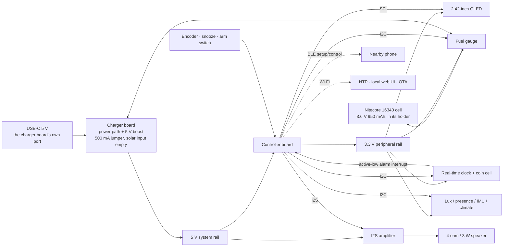

# Hardware architecture

## Baseline decision

Build the first alarm-first prototype around the **[controller board](https://www.digikey.com/en/products/detail/espressif-systems/ESP32-S3-DEVKITC-1-N8R8/15295894)**, an ESP32-S3 development board with 8 MB flash and 8 MB PSRAM. It has enough flash/PSRAM for a framebuffer, local web assets, audio samples, and dual OTA slots; native USB helps development. A later custom board can move to a 16 MB module or the external-antenna variant of the same module if the brass cradles degrade RF performance.

The development board is deliberately separate from the power system (the charger board and the cell). During bench work it is USB-powered. Battery integration happens only after alarm and brownout tests pass.

## System diagram

## Power (Rev B, 2026-10-31)

USB-C is the supply. The [charger board](https://www.adafruit.com/product/6106)'s own USB-C port comes through a cutout in the removable rear panel; its solar/VIN input is left empty. The board's 5 V boost output feeds the [controller board](https://www.digikey.com/en/products/detail/espressif-systems/ESP32-S3-DEVKITC-1-N8R8/15295894)'s 5V pin and the [amplifier](https://www.adafruit.com/product/3006)'s VIN; the dropout rule from the power pages still applies, now only while unplugged: the 5 V rail must stay above about 3.7 V (corrected 2026-10-31 from 4.4 V; the controller board's regulator is a low-dropout part).

One Nitecore 16340 cell (3.6 V, 950 mAh, protected) sits in the [16340 holder with leads](https://www.amazon.com/dp/B0CRGK889F) on a JST-PH pigtail, through the [fuel gauge](https://www.adafruit.com/product/5580), into the charger board's BAT port. Charger jumper cut to 500 mA (it ships closed at 1 A), about 0.5 C. The cell is about 3.4 Wh: many hours with the face dark, roughly 10 h lit. It rides through unplugs and keeps the alarm armed; it is not meant to run the clock for days.

Envelope: 82 W × 52 H × 68 D mm, printed black PETG on two brass U cradles, laid out part by part in [COMPACT_DESIGN.md](COMPACT_DESIGN.md). Nothing solar is wired; the 5 W panel and its jack parts are owned stock for another project.

For a custom production carrier, use the 3.3 V buck variant of the [charger board](https://www.adafruit.com/product/6106)'s charger chip for the digital rail and run the amplifier from the battery/system rail. This avoids an always-on boost conversion. The 5 V boost breakout is recommended only for the more forgiving development-board prototype.

## Controller and Bluetooth choice

| Path | Strength | Limitation | Choose when |
|---|---|---|---|
| [Controller board](https://www.digikey.com/en/products/detail/espressif-systems/ESP32-S3-DEVKITC-1-N8R8/15295894) baseline | Current ESP-IDF support, native USB, BLE, roomy memory, good alarm/UI platform | No Bluetooth Classic, A2DP, or LE Audio | Speaker plays local alarm/chime content |
| [Wi-Fi and Bluetooth Feather board](https://www.adafruit.com/product/5400) SoundDock variant | Wi-Fi, BLE, and Classic Bluetooth/A2DP; compact | Older ESP32, separate charger interaction, more RF/audio power and concurrency work | Phone music streaming is a firm requirement |
| ESP32-S3 + dedicated BT audio module | Keeps S3 architecture and isolates streaming | Added module, cost, controls, mixing, certification, and standby draw | Product version must have both S3 and conventional BT audio |

Recommendation: ship the first prototype with local audio. Do not market the S3 device as a Bluetooth speaker. If the SoundDock variant is built, an alarm must preempt streaming and a local synthesized tone must remain available if the audio stack fails.

## Buses and address plan

| Bus | Devices | Notes |
|---|---|---|
| SPI | [OLED display](https://www.adafruit.com/product/2719) | 4-wire mode; no readback required |
| I2S TX | [Amplifier](https://www.adafruit.com/product/3006) | Mono PCM; amp shutdown asserted outside playback |
| I2C | [Real-time clock](https://www.adafruit.com/product/5188), [fuel gauge](https://www.adafruit.com/product/5580), [rotary encoder](https://www.adafruit.com/product/6310) control, [proximity and light sensor](https://www.adafruit.com/product/4161), IMU, [temperature and humidity sensor](https://www.adafruit.com/product/4566), optional air sensor | Audit combined pull-ups to 3.3 V; isolate a failed optional daughterboard if needed |

| I2C device | Address |
|---|---:|
| Proximity and light sensor | `0x60` |
| Real-time clock | `0x68` |
| Fuel gauge | `0x36` |
| Temperature and humidity sensor | `0x38` |
| Rotary encoder's I2C adapter | `0x49` default |
| [Accelerometer](https://www.adafruit.com/product/2809) | `0x18` or `0x19` |
| ENS160, optional | `0x52` or `0x53` |
| BMI160 alternative | Force `0x69`; `0x68` conflicts with the real-time clock |

## Provisional ESP32-S3 pin plan

This allocation is for the [controller board](https://www.digikey.com/en/products/detail/espressif-systems/ESP32-S3-DEVKITC-1-N8R8/15295894) or a custom module carrier and must be checked against the exact board revision before soldering. It intentionally reserves native USB and UART pins and avoids common strapping pins.

| Function | GPIO | Notes |
|---|---:|---|
| I2C SDA / SCL | 8 / 9 | Shared peripheral bus |
| OLED SCLK / MOSI | 12 / 11 | 4-wire SPI |
| OLED CS / DC / RESET | 10 / 6 / 7 | Dedicated control lines |
| I2S BCLK / WS / DOUT | 14 / 15 / 16 | Amplifier |
| Amplifier shutdown | 17 | Default low/off during boot |
| Real-time clock INT/SQW | 4 | Pull up to 3.3 V; wake-capable input |
| Rotary encoder interrupt | 1 | Primary I2C control; active-low pulse can avoid polling |
| Direct encoder A / B / push | 1 / 2 / 5 | Budget alternative only; replaces the I2C encoder |
| Snooze button | 18 | Dedicated active-low input |
| Alarm-arm switch | 21 | Logical arm/disarm, not battery disconnect |
| Backup buzzer MOSFET | 47 | Optional; never drive a load directly from GPIO. Not 38 or 48: the DevKit RGB LED lives there |
| Sunrise lamp MOSFET gate | 40 | Added 2026-11-05. PWM through 100 Ω, 10 kΩ gate pull-down; the filament runs from the cell, not the 5 V boost (WIRING_CROSSREF finding 7) |
| Fuel-gauge alert | 39 | Optional |
| IMU interrupt | 5 | Optional motion/tap wake; RTC-capable so a tap can wake from deep sleep |
| Charger status | 41 | Optional; respect breakout logic level |
| Native USB D− / D+ | 19 / 20 | Reserved |
| UART0 TX / RX | 43 / 44 | Reserved for logs/recovery |

Avoid GPIO 0, 3, 45, and 46 for user controls because they are strapping-sensitive. Avoid GPIO 35–37 when octal flash/PSRAM consumes them. The same mapping is captured as provisional constants in `firmware/main/include/board_pins.h`.

## Alarm-reliability path

1. The [real-time clock](https://www.adafruit.com/product/5188) keeps UTC from its coin cell even if the main pack is disconnected.
2. Firmware computes the next occurrence of every enabled local alarm, converts it to UTC, and programs the clock's Alarm 1.
3. The clock's active-low interrupt wakes the ESP32 or is sampled immediately after reset.
4. Audio initializes and the alarm begins **before** Wi-Fi, BLE, weather, or optional sensors.
5. Snooze expiry is persisted and reprogrammed into the clock, so a reset cannot silently cancel it.
6. Firmware records the wake cause and clears the clock's alarm flag; that output stays low until cleared.
7. A procedural tone is always compiled in. A corrupt WAV file cannot make the alarm silent.

The arm switch controls scheduler state; it is not a hard power switch. A physically powered-off clock cannot be a reliable alarm.

## Power sequencing

- Start with amp shutdown asserted and OLED off.
- Validate the real-time clock and pending alarm.
- If an alarm is due, start the fallback tone, then load the selected asset.
- Bring up OLED at low contrast.
- Read battery/fuel gauge and choose a power mode.
- Start Wi-Fi/BLE and optional sensors last, one load at a time.
- While unplugged, keep the radio from transmitting during alarm playback: a Wi-Fi burst on top of a bass peak is the one coincidence that exceeds the boost's 1 A rating and the cell's 2 A rating (REVIEW.md, Rev B verification).

This sequencing reduces cold-start stress on the [charger board](https://www.adafruit.com/product/6106) and makes a radio failure irrelevant to wake-up.

## Electrical and mechanical rules

- ESP32 GPIO is not 5 V tolerant. All I2C pull-ups terminate at 3.3 V.
- Add 100 nF at each module, 10–22 µF near display/radio loads, and 220–470 µF near the amplifier.
- Audit the aggregate I2C pull-up resistance. Several STEMMA QT breakouts include their own pull-ups; remove/disable extras if the parallel value is too strong.
- The [amplifier](https://www.adafruit.com/product/3006) is bridge-tied; neither speaker lead connects to ground.
- Keep class-D and speaker wiring away from the real-time clock, I2C, and the antenna.
- Keep the PCB antenna away from the two brass cradles; the controller lies low in the main zone and the cradles are under the floor. Test RSSI with the cradles fitted; use the external-antenna module if needed.
- Isolate the two brass cradles from every net; meter cradle-to-net isolation before power. If a brass part becomes a touch electrode, add series resistance and ESD protection.
- Only one circuit charges the cell. Do not connect the development board's battery charger and the charger board to the same cell, and never put the 16340 and a LiPo pack on the BAT port together.
- Prevent the [controller board](https://www.digikey.com/en/products/detail/espressif-systems/ESP32-S3-DEVKITC-1-N8R8/15295894)'s USB 5 V rail and external boosted rail from back-feeding each other; use a power mux/ideal diode or disconnect external power during USB development.
- Keep the 16340 cell in its holder under the lid, front right, retained and serviceable, away from the speaker magnet; meter the holder leads for polarity before the cell meets anything.

## Optional sensing

The base design includes presence/ambient light because it directly saves OLED energy and wear, and a hand over the lid hole is how the face wakes. Temperature/humidity is inexpensive and useful. Orientation/tap sensing preserves the original flip-to-focus interaction.

Air quality is a daughterboard, not a blocker. ENS160 reports equivalent CO2 inferred from metal-oxide gas response; it is not a direct CO2 instrument. If the product claims actual CO2, use a [CO2 sensor](https://www.adafruit.com/product/5190) and accept the roughly $50 and energy cost.

## Productization changes after prototype

- One USB-C connector with VBUS routed to the PMIC, USB D+/D− to the S3, CC resistors, ESD, and no backfeed path.
- Custom carrier with load switches for OLED, optional sensors, and amp.
- External antenna option if the brass frame reduces link margin.
- Battery NTC and verified charge-current configuration.
- Signed dual-slot OTA, secure boot/flash encryption as appropriate, recovery button, and accessible programming pads.
- EMC/ESD, battery thermal, acoustic, and enclosure abuse testing before distribution.

## Change notes

- Rev B 2026-10-31: solar removed, compact body, 16340 cell. Pins unchanged.
