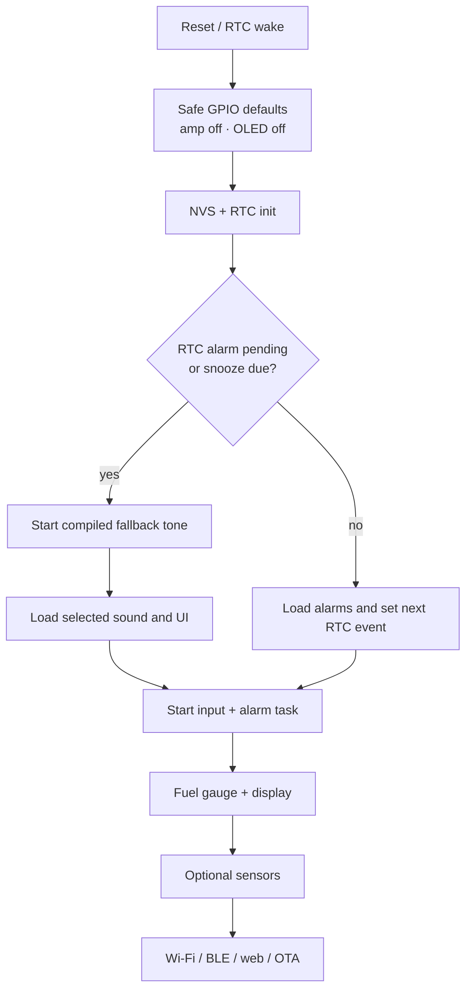
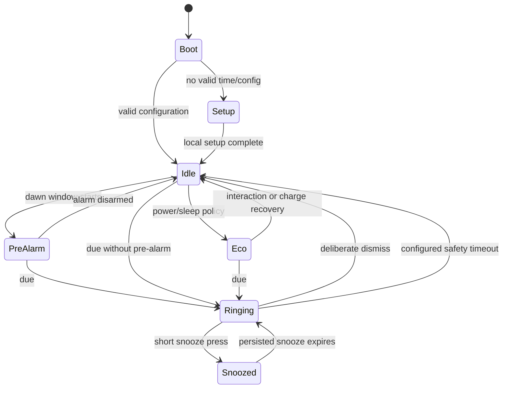

# Firmware and software plan

## Non-negotiable invariants

1. A configured alarm fires without Wi-Fi, Bluetooth, a phone, or cloud service.
2. The alarm path starts before optional sensors and network services.
3. A reboot, NTP correction, DST transition, corrupt audio asset, or failed sensor cannot silently cancel an alarm.
4. Credentials and private settings are provisioned; they are never compiled into source control.
5. Low power can simplify the UI and connectivity, but it does not quietly disarm the next alarm.

## Stack

- **Framework:** ESP-IDF for FreeRTOS tasks, watchdogs, NVS, BLE provisioning, HTTP server, I2S, power management, and rollback-capable OTA.
- **Target:** `esp32s3`; first board is the [controller board](https://www.digikey.com/en/products/detail/espressif-systems/ESP32-S3-DEVKITC-1-N8R8/15295894).
- **Display:** a small 1-bit framebuffer and an SPI driver for whichever controller chip the [OLED display](https://www.adafruit.com/product/2719) revision carries. Avoid a large UI framework for the 128×64 MVP.
- **Audio:** ESP-IDF standard-mode I2S TX with mono PCM assets in LittleFS; procedural tone generator compiled into the app.
- **Storage:** NVS for versioned settings/alarm records; LittleFS or a read-only data partition for UI/audio assets; two application slots for OTA.
- **Networking:** `esp_netif`, SNTP, mDNS, local HTTP server, BLE provisioning, HTTPS OTA.
- **Testing:** native C/C++ alarm-domain tests on the host plus ESP-IDF Unity tests and hardware-in-loop scripts.

Use a supported ESP-IDF 5.x release selected when implementation starts and pin it in developer setup/CI. Do not float against an unversioned toolchain.

## Runtime structure

```text
firmware/
  main/
    app_main.c                 boot ordering only
    include/board_pins.h       provisional board support map
  components/
    bsp/                       GPIO, rails, encoder, buttons
    drivers/                   OLED, RTC, fuel gauge, amp, sensors
    domain/                    pure time/alarm recurrence logic
    services/                  time, alarm, audio, power, connectivity
    ui/                        framebuffer, screens, fonts
    web/                       embedded local PWA/API
  tests/
    host/                      recurrence and DST vectors
    target/                    driver and integration tests
  partitions.csv
```

The initialized directory only contains the boot scaffold and proposed pin header. Add modules in vertical slices as the build gates pass.

## Boot order



No connection attempt may block the boot task. Every peripheral probe has a deadline and a degraded mode.

## Services

| Service | Responsibility | Failure behavior |
|---|---|---|
| Time service | Real-time clock read/write, monotonic/system clock, SNTP correction, timezone conversion | Stay on the real-time clock; show stale-sync indicator |
| Alarm scheduler | Recurrence, next-event calculation, the real-time clock's Alarm 1, snooze persistence, duplicate suppression | Use last valid schedule and compiled tone |
| Audio service | I2S DMA, volume ramp, WAV/ADPCM decode, synthesized fallback | Restart I2S once, then piezo/fallback tone if fitted |
| UI service | OLED framebuffer, screens, contrast, pixel shift, presence blanking | Alarm remains audible; status available via logs/web |
| Input service | Encoder, directional buttons, snooze, arm switch, tilt/tap | Dedicated snooze and arm inputs have priority/debounce |
| Power manager | State of charge from the fuel gauge, USB present or not, load policy, estimated unplugged runtime for the battery gauge on the face | Enter reserve mode and retain alarm path |
| Connectivity | BLE setup, Wi-Fi reconnect, mDNS, local HTTP API | Back off; never stop alarm/time tasks |
| OTA service | Signed/validated download, dual-slot activation, rollback | Keep current image; disallow near alarm/low battery |
| Diagnostics | Reset reason, wake cause, missed/late counter, oscillator-stop flag, battery minimum | Ring alarm even if diagnostics cannot persist |

## Time model

- The [real-time clock](https://www.adafruit.com/product/5188) stores **UTC**, not local wall time.
- System monotonic time controls durations such as ringing, fade, and snooze countdown once booted.
- Settings store a human-readable IANA zone ID plus a versioned embedded POSIX TZ rule or compact zone-table entry. A fixed `UTC-5` offset is not sufficient for US DST.
- On a good SNTP sync, correct the system clock, update the real-time clock, record sync age/quality, and recompute the next alarm.
- Large corrections are logged; while ringing, do not let a backward network correction restart or prolong the alarm.
- If the real-time clock's oscillator-stop flag is set and no trustworthy network/phone time exists, show a blocking “set time” state. Existing alarm definitions remain stored but are not represented as reliable until time is valid.

## Alarm data model

```c
typedef struct {
    uint32_t id;
    bool enabled;
    uint16_t local_minute_of_day;   // 0..1439
    uint8_t weekday_mask;           // bit 0 = Monday
    char label[24];
    uint8_t sound_id;
    uint8_t volume_start;
    uint8_t volume_max;
    uint16_t fade_seconds;
    uint16_t snooze_minutes;
    uint8_t max_snoozes;
    uint8_t dst_policy;
    int32_t last_fired_local_day;   // duplicate guard
} cyber_alarm_t;
```

Store records with a schema version, length, and checksum. Keep the active schedule and last-known-good copy in separate NVS keys. Persist snooze target in UTC before muting the speaker, then program the real-time clock.

## Alarm state machine



The connectivity service is intentionally absent from this state machine. Network state is never a prerequisite for alarm transitions.

## Calendar and DST behavior

Unit tests must define these policies before UI work:

- **Spring-forward missing time:** an alarm in the skipped interval fires at the first valid local minute after the jump.
- **Fall-back repeated time:** fire once, using `last_fired_local_day` plus alarm ID to suppress the duplicate occurrence.
- **Backward NTP step:** do not refire an alarm already recorded for that local day/occurrence.
- **Forward NTP step across an alarm:** fire immediately if within a configurable grace period; otherwise record it as missed and show an alert.
- **Multiple alarms at the same minute:** merge them into one ringing session and retain all labels; do not mix multiple audio streams.
- **Reboot while ringing:** resume if still within the alarm timeout.
- **Reboot while snoozed:** read the persisted UTC target and reprogram the real-time clock.
- **Arm switch off:** cancel pre-alarm/ringing and clear the real-time clock's alarm flag, but preserve alarm definitions.

## Audio behavior

- Begin with a quiet local tone immediately, then ramp toward `volume_max` over `fade_seconds`.
- Decode short mono assets from local storage; normalize assets offline to avoid runtime floating-point work.
- Keep a procedural two-tone fallback in application flash, independent of the filesystem.
- Assert the [amplifier](https://www.adafruit.com/product/3006)'s shutdown whenever audio is idle.
- Reduce or pause network activity during loud playback to improve rail and RF margin.
- Impose a tested maximum volume; the physical enclosure determines the final safe/acoustically useful setting.
- Optional piezo fallback is driven through a transistor/MOSFET, never directly from a GPIO.

## OLED policy

- Limit normal refresh to a few frames per second; update static time fields only when they change.
- Use a black background and avoid a permanently illuminated colon/status bar.
- Move the origin by one pixel on a schedule and rotate among two or three clock layouts.
- Map lux to a capped contrast curve with hysteresis.
- Blank or reduce to a sparse time face after the presence timeout.
- Disable seconds and animation in eco mode.
- Keep the OLED off during early boot until USB presence and the cell's state are known.
- The battery gauge is a plain gauge: state of charge and an estimated unplugged runtime. No energy history, no input logging (solar was removed 2026-10-31).

## Connectivity

### BLE

- First-run Wi-Fi credential provisioning
- Phone-provided current time/timezone as an offline setup fallback
- Alarm/settings read/write nearby
- Explicit provisioning mode with timeout; normally disable advertising to save energy

### Wi-Fi

- SNTP synchronization
- `cyberdawn.local` responsive web UI and JSON API on the LAN
- OTA update
- Optional MQTT/Home Assistant integration after MVP

Use proof-of-possession for provisioning, protect configuration writes with a local device secret/session, and never expose an unauthenticated Internet-facing service. Weather or cloud APIs are optional adapters with timeouts and cached results.

The controller's speaker is not an A2DP sink. The Classic-Bluetooth [Feather board](https://www.adafruit.com/product/5400) variant requires a separate build target and audio arbitration layer; a due alarm always disconnects or mutes the stream.

## OTA policy

- Two application slots and automatic rollback if the new image does not reach a healthy checkpoint.
- Reject OTA below the battery threshold, while ringing/snoozed, or within a conservative window before the next alarm.
- Verify transport and image authenticity before distribution; development builds may begin with vendor-secure HTTPS and later add signed app verification.
- A firmware update may migrate settings only with a tested rollback path or preserved backward-compatible schema.

## Implementation work packages

| Package | Main output | Rough prototype effort |
|---|---|---:|
| P0 foundation | Build/CI, logging, board support, safe GPIO defaults | 1–2 engineer-days |
| P1 time + alarm domain | Pure recurrence engine, real-time clock driver, NVS schema, host test vectors | 4–6 days |
| P2 audio + controls | I2S, fallback tone, ramp, encoder/snooze/arm handling | 3–5 days |
| P3 OLED UI | Clock/alarm screens, pixel shift, contrast/presence policy | 3–5 days |
| P4 provisioning/network | BLE or captive setup, SNTP, mDNS/local API | 4–6 days |
| P5 power | Fuel gauge, battery gauge on the face, power states, unplug/replug handling | 3–5 days |
| P6 OTA/hardening | Dual-slot update, rollback, fault injection, HIL runner | 4–7 days |

Total: roughly **22–36 engineer-days** for a dependable prototype, excluding custom PCB, enclosure CAD, certification, and a polished mobile app. The local web UI avoids requiring a native app for MVP.

## Test matrix

| Area | Required cases | Acceptance |
|---|---|---|
| Recurrence | Month/year boundaries, leap day, weekday masks, same-time alarms | Exact expected next UTC event |
| DST | US spring gap and autumn repeat, timezone change | Defined policy; never zero or duplicate unintended rings |
| Offline | Wi-Fi absent for 72 h, phone absent, DNS failure | Alarm on time from the real-time clock |
| Reset/brownout | Reset 60 s before alarm; reset while ringing/snoozed | Alarm fires/resumes; snooze survives |
| Real-time clock | Empty coin cell, oscillator-stop flag, stuck-low interrupt | Visible fault; no wake loop |
| Audio/power | Max volume + Wi-Fi TX + OLED; battery and weak source | No reset, glitch, or real-time clock corruption |
| Storage | Corrupt NVS copy, corrupt WAV, interrupted update | Last-good settings/fallback tone/rollback |
| UI/OLED | Lux transitions, presence, pixel shift, prolonged dark mode | Legible, stable, no stuck bright screen |
| Inputs | Bounce, stuck key, accidental touch, deliberate dismiss | Snooze responsive; dismiss not accidental |
| Sensor faults | Missing/stuck I2C optional device | Alarm/time continue normally |
| RF | Bare board versus completed brass frame and active amp | Adequate provisioning and LAN margin |

Before calling the alarm MVP complete, run thousands of accelerated scheduler events and at least 30 real wake events triggered by the real-time clock across cold boots and network loss.

## Scaffold status

The repository currently provides:

- ESP-IDF project entry point
- dual-OTA/storage partition layout for an 8 MB target
- provisional board pin definitions
- safe, hardware-neutral boot loop

ESP-IDF is not installed in this environment, so the scaffold is not claimed as compiled firmware. The first implementation commit should pin the toolchain, add CI, and replace provisional pins only after the exact board schematic is checked.

## Change notes

- Rev B 2026-10-31: solar removed, compact body, 16340 cell. The energy view became a battery gauge; P5 lost its solar telemetry.
