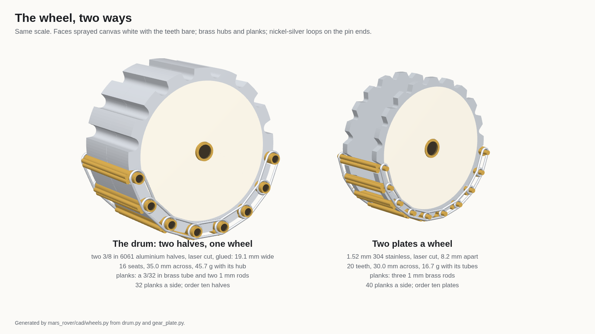
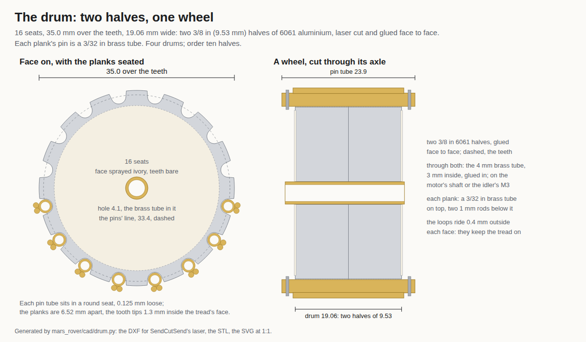
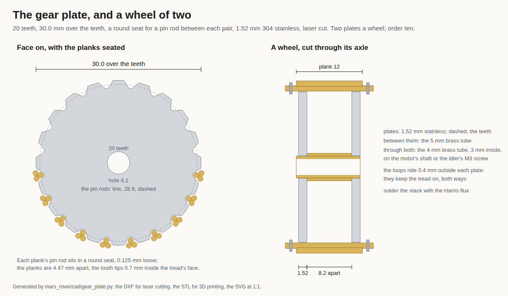

# Wheels to have cut, on SendCutSend's laser

**How the reference did it.** Huy Vector didn't make his wheels. PCBWay machined them, the sponsor spot at 3:16 to
3:44 of [the video](https://www.youtube.com/watch?v=PszrmrE7JQU&t=196s). They are four solid aluminium drums, about
30 mm across and about 22 mm wide, with about 15 narrow square grooves along the rim and a small hole through the
middle ("perfect fit" on the frame at 3:36; a notched disc of the drum's profile against a ruler at 3:43, the drums
standing behind it). Then each drum is his jig for the tread: rods laid in its grooves, tied with black thread, the
links soldered (4:22). [His page](https://www.huyvector.org/robots-kinetic/diy-micro-rc-spy-tank) only lists parts and
tools.

**Ours, on the laser:** two 3/8 in aluminium halves glued into one drum 19 mm wide. The builder said yes to the drum on
2026-11-08 and asked for it wider, like the reference's; this is that. Rev I (2026-11-09) made it
35 mm across with 16 seats, at the builder's word; Rev J keeps it, without Rev I's LiDAR. The two-plate
stainless wheel after it was drawn for Rev H's 30 mm wheel and stays only as a fallback.

Both wheels to one scale: [`mars-rover-wheels.png`](mars-rover-wheels.png), drawn by [`wheels.py`](wheels.py) from the
two generators' shapes (three.js in headless Chrome, so it needs the network): `python3 wheels.py`.

## The drum: two halves, one wheel (approved 2026-11-08; 35 mm since Rev I, 2026-11-09)

**16 seats, 35.0 mm over the teeth, 19.06 mm wide: two halves cut from 9.53 mm (3/8 in) 6061 aluminium, glued face to
face.** Each plank's pin is a 3/32 in brass tube that drops into a round seat. Two halves a wheel; order ten.

| File | What it is |
| --- | --- |
| [`mars-rover-drum.dxf`](mars-rover-drum.dxf) | Upload this, one half: one closed outline and the 4.1 mm hole, in mm |
| [`mars-rover-drum.stl`](mars-rover-drum.stl) | One half in 3D, 9.53 mm thick |
| [`mars-rover-drum.svg`](mars-rover-drum.svg) | One half at 1:1, in mm |
| [`mars-rover-drum.png`](mars-rover-drum.png) | The preview above |
| [`drum.py`](drum.py) | The generator; it borrows the outline and the writers from `gear_plate.py`. Run `python3 drum.py` |

### Ordering

- **Where:** [SendCutSend](https://sendcutsend.com/materials/6061-aluminum/), laser cutting. Upload the DXF; the
  price shows as you go. No account is needed to see it.
- **Price:** the 35 mm half is $4.21 each for ten, **$42.10**, read 2026-11-09 (one $6.60, two $5.08, 50 $3.10,
  100 $2.80, 1000 $2.55), standard shipping free, arriving as soon as Nov 14. Ten wait in the builder's SendCutSend
  cart, not paid; the Rev H line (30.5 mm, $3.61 each, $36.10) came out of the cart the same day.
- **Units:** SendCutSend reads the file as inches, though it declares millimetres. Click the underlined **in** under
  the drawing, then **Change to mm**. It must read 35 × 35 mm: with 16 seats a tooth sits square both ways.
- **Material:** Metals, Aluminum, 6061-T6, 0.375 in (9.5 mm). Their tolerance is ±0.005 in. The 5/8 and 3/4 in
  plates are greyed out for a part this small: 3/4 in's smallest part is 76 mm across.
- **Services and finishing:** none. Deburring and tumbling are greyed out for this part, so file the seats by hand.
- **Quantity:** 10: eight halves for four drums, two spares.

### Why it is shaped this way

- **Two halves, not one thick plate.** Thicker plate means bigger minimum features. At 3/8 in 6061, SendCutSend's
  smallest hole is 2.16 mm (3.33 recommended) and its smallest bridge 3.63 mm; at 1/2 in they are 3.18 and 4.83 mm.
  A one-piece 1/2 in drum would be only 12.7 mm wide, with 11 coarse seats for 1/8 in pins. Two 3/8 in halves make
  19.06 mm and keep 14 seats. His drums are about three-quarters as wide as they are across (read off 3:36 to 3:42);
  ours are about two-thirds. His grooves came off a milling machine, not a laser.
- **Tube pins.** A 3/32 in brass tube is 2.38 mm. Its seat is 2.63 mm, 0.125 mm loose all round, so the laser's
  ±0.127 mm never pinches it. That clears the minimum, not the recommended size. If a seat comes out rough, run a
  round needle file through it.
- **16 seats, 6.52 mm apart, 35 mm across (since Rev I):** a little bigger than the reference's, at nearly its pitch. The
  flat tooth tops are 3.75 mm wide, just over the 3.63 mm bridge rule; 17 seats would make them 3.35. The flanks lean
  only 15° (the plate's 40° would eat the teeth). Rev H's drum was 30.5 mm with 14 seats.
- **Weight:** 22.4 g a half, 45.7 g a drum with its hub. Rev J, without the LiDAR, is about 328 g; the motors
  turn it on the spot with about 29 times the torque it needs.
- **The tread:** 32 planks a side and 128 loops, about 8 hours of soldering, 55 g of brass, 19.9 mm wide. Its face
  rides 37.6 mm across, so the axles sit 18.8 mm up, 2.2 mm higher than Rev H's.

### One wheel

1. Cut 21.4 mm of the owned 4 mm brass tube (3 mm inside) and slide both halves on, faces together.
2. Lay a 3/32 in pin tube across both halves in one seat so the seats line up. Glue the halves to each other and to
   the tube with the gel super glue: the tube stands 0.5 mm proud of the outer face and 1.8 mm out of the inner one,
   to the gearmotor's boss.
3. Spray the outer faces canvas white, with the teeth masked so they stay bare aluminium.
4. Drives: crimp the tube on the motor's flat. Idlers: the tube turns on the M3 screw.
5. Each plank: 23.9 mm of 3/32 in brass tube on top, two 19.9 mm pieces of 1 mm rod below it, soldered with the
   Harris flux. Build the tread round the drum itself, as the reference does: tubes in the seats, tied with thread,
   then the loops.

New to buy for it: the ten halves, and about 1.5 m of 3/32 in brass tube (64 pins, so six 12 in lengths). The planks
take about 2.7 m of 1 mm rod.

## The plate: two a wheel (the fallback)

Drawn for Rev H's 30 mm wheel and its 1 mm-pin tread; not redrawn for the 35 mm drum.

**20 teeth, 30.0 mm over the teeth, cut from 1.52 mm (0.060 in) 304 stainless**, with a round seat between each pair
of teeth for a plank's 1 mm pin rod. Two plates a wheel, 8.2 mm apart on the owned 4 mm tube, hollow between. Order
ten. Each plate is 7.8 g.

| File | What it is |
| --- | --- |
| [`mars-rover-gear-plate.dxf`](mars-rover-gear-plate.dxf) | Upload this: one closed outline and the 4.1 mm hole, in mm |
| [`mars-rover-gear-plate.stl`](mars-rover-gear-plate.stl) | The same plate in 3D, 1.52 mm thick |
| [`mars-rover-gear-plate.svg`](mars-rover-gear-plate.svg) | The plate at 1:1, in mm |
| [`mars-rover-gear-plate.png`](mars-rover-gear-plate.png) | The preview above |
| [`gear_plate.py`](gear_plate.py) | The generator: `python3 gear_plate.py` |

- **Order:** SendCutSend, 304 stainless 0.060 in, millimetres (30.0 mm across), quantity 10. A same-size stand-in
  from its gear template was $0.89 each for ten ($8.90) and $0.76 each for thirty ($22.80) on 2026-11-07, both under
  its $29 order minimum.
- **Seats:** 1.25 mm for the 1 mm pins, 0.125 mm loose all round for the laser's tolerance (widened on 2026-11-07
  from 1.1 mm, which could have pinched). The tooth tips are 2.0 mm wide and stay 0.7 mm inside the tread's face.
- **Hollow, not solid:** a plank spans the 8.2 mm gap like a little bridge. With a whole wheel's share of the rover
  on it, one 1 mm brass rod sees about 11 MPa, a twentieth of what brass takes. A solid wheel would be seven plates,
  56 g against 17 g, taking the rover from about 186 g to 343 g.
- **One wheel:** stack plate, 8.2 mm of the owned 5 mm tube, plate on 11.5 mm of the owned 4 mm tube. Solder with the
  Harris flux, rinse with baking soda and alcohol, and spray the outer face canvas white with the teeth masked.
