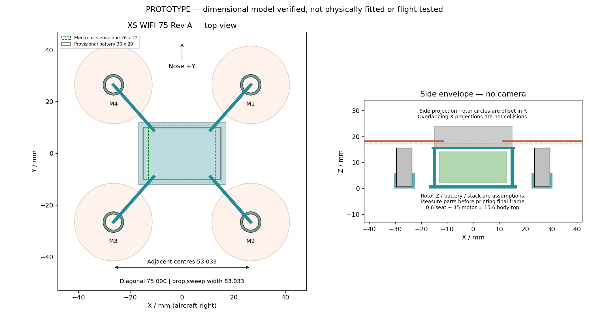

# XS drone — Wi-Fi build and engineering package

**Recommended build:** one [Seeed × Max Imagination ESP-FLY kit](https://www.seeedstudio.com/ESP-FLY-co-create-p-6744.html), using its supplied frame first. It provides the Wi-Fi-compatible successor to the brushed Arduino drone in the [requested video](https://www.youtube.com/watch?v=Sa6EslOHsI0). The selected feature set is **phone Wi-Fi control and telemetry**, with **optional separate analog FPV**. Integrated Wi-Fi video is not implemented by this firmware.

The project now includes actual purchase links, a detailed electrical/software audit, assembly instructions, a custom editable frame, digital test results and a physical acceptance plan. Research and prices were checked **2026-10-01**, assuming US purchasing. No parts have been purchased and no physical drone was available for testing.

## Start here

| Read / use | What it contains |
|---|---|
| [Engineering assessment](docs/engineering-assessment.md) | Original-video discrepancies, design choices, thrust/mass/current calculations and unresolved ratings |
| [Payload assessment](docs/payload-assessment.md) | Camera, microphone, ToF ranging, flashlight, attitude sensing and speaker verdicts, pin budget, mass ledger, stainless rod frame and the smallest layout (2026-10-27, flashlight 2026-10-28) |
| [Custom build](docs/custom-build.md) | The drone without the ESP-FLY kit: battery check, loose-part buy list, hand-built driver circuit checked against the pin map, car-like ladder frame 40 × 60 mm, mass and build order (2026-10-28) |
| [Voice physics](docs/voice-physics.md) | Step two for the microphone and speaker added and approved 2026-11-09: the PDM microphone and its clock, the sigma-delta DAC on the one free pin, the divider that is also the filter, the class-D bridge on the pack, the sealed speaker, what the grams cost, the propeller limit; six figures, two simulated; web version [XS Drone Voice Physics](https://claude.ai/artifact/F1GaiD5tUNSf6gDL87SgtG); PDF in docs/pages/print/voice-physics.pdf (2026-11-10) |
| [Purchasing guide](docs/purchasing.md) / [BOM CSV](hardware/bom.csv) | Direct product links, quantities, prices, tools, rejected substitutions and conditional FPV parts |
| [Assembly and execution plan](docs/assembly-plan.md) | Receiving, soldering, setup, bench qualification, flight progression and custom-frame migration |
| [Wiring](docs/wiring.md) | Motor locations/directions, exact GPIOs, battery rails and schematic evidence |
| [Wi-Fi architecture](docs/wifi-options.md) | Phone/app setup, telemetry, alternatives, and the difference between Wi-Fi control and video |
| [Software setup](firmware/README.md) / [firmware audit](docs/firmware-audit.md) | Pinned source, local hardening patch, reproducible build and regression tests |
| [Frame jig](https://claude.ai/artifact/NgbYaHbAoW2Ta996yeXkPF) | 1:1 Letter sheet for the stainless ladder frame: cut list, collar check, solder order; PDF in docs/pages/print/frame-jig.pdf (2026-11-06) |
| [Frame design](docs/frame-design.md) | Dimensions, tolerances, print workflow, fit coupon, CAD model limits (kit-era printed frame, superseded by the ladder frame) |
| [Acceptance tests](docs/acceptance-tests.md) / [measurement log](verification/measurement-log.csv) | Specific physical pass/fail checks; every hardware test starts as NOT RUN |
| [Evidence manifest](sources/evidence.json) | Source URLs, revision identifiers and hashes of public creator references |

## Purchase scope and price

The kit listing showed **$59.99 in stock**; kit plus data cable totals **$64.94**. The researched kit plus a complete basic soldering/measurement tool selection totals **$216.84**, before shop extras, tax and shipping. A scope, current-limited supply, thrust fixture and 3D printer access are separate workshop resources. See [purchasing.md](docs/purchasing.md) before ordering; optional/rejected rows are not a shopping cart. Availability at checkout and battery shipping depend on destination.

## What has actually been verified

| Evidence | Result and meaning |
|---|---|
| Creator PCB manufacturing files | Outline **17.750 × 21.000 mm**, closed loop, fourteen 1.1 mm header holes; file hashes verified. This is a historical bare PCB, not a measured retail stack. |
| Custom frame | Valid solid, watertight single mesh, mass estimate and rotor/motor solid-clearance checks. Real print fit and strength remain untested. |
| ESP-FLY firmware | Patched ESP32-S3 source builds with ESP-IDF 5.0.7; actual-source host regression tests exercise control/link-loss decisions and malformed lengths. See saved reports for exact counts and hashes. |
| Original video firmware | Host test reproduces a full-throttle command after radio timeout. **Do not fly that downloaded firmware unchanged.** |
| Purchased electronics and flight | **Not tested.** Connector current, diode repetitive current, rail transients, sensor orientation, real app loss/reconnect behavior and flight stability remain required gates. |

Detailed evidence: [CAD report](verification/cad-report.json), [Gerber report](verification/gerber-report.json), [firmware build and host-test report](firmware/build-report.json), and [package consistency report](verification/package-report.json).

The kit is the best-supported prototype purchasing path found, not a certification of every electrical rating. In particular, the historical PH connector's 2 A rating and small flyback diodes must be checked against actual loaded current before approving flight. The patch improves known software behaviors, but cannot qualify those components or compensate for a bad physical assembly.

## Frame deliverables

The independent **XS-WIFI-75 Rev A** has a 75 mm diagonal wheelbase, 30 mm propellers and an 83.033 mm swept footprint. The ideal solid-PLA estimates are **1.94 g frame + 1.45 g battery bridge = 3.39 g**, excluding retainers, glue, insulation and landing gear. Its provisional battery/electronics envelopes clear the rotors by at least **3.82 / 4.27 mm**, and the bridge by **2.43 mm**, after the declared placement/radius tolerance allowance. The battery size, stack height and rotor height are assumptions awaiting measurement.

[Dimensioned drawing PDF](cad/generated/dimensioned-layout.pdf) · [Frame STEP](cad/generated/xs_wifi_75_frame.step) · [Frame STL](cad/generated/xs_wifi_75_frame.stl) · [Battery bridge STL](cad/generated/battery_bridge_print.stl) · [Fit coupon STL](cad/generated/motor_fit_coupon.stl) · [Assembly STEP](cad/generated/clearance_assembly.step) · [Editable parameters](cad/parameters.json)



Use the included kit frame first; the custom model changes inertia and requires retesting. The custom model has no camera mount or prop guards. No paid creator STL was copied into this package.

## Re-run the local checks

```sh
python3 tests/verify_gerber.py
python3 tests/verify_package.py

# Regenerate CAD and repeat its actual solid/mesh tests:
uv venv --python 3.11 .venv/cad
uv pip install --python .venv/cad/bin/python -r cad/requirements.txt
.venv/cad/bin/python cad/generate.py
python3 tests/verify_package.py
```

For firmware host and target checks, use [firmware/README.md](firmware/README.md). The build script does not flash hardware. A generated private Wi-Fi password is stored only in the ignored build work area; firmware binaries contain it and should not be shared publicly.

Primary reference ownership remains with Max Imagination, Seeed, Espressif and the credited upstream contributors. The supplied firmware patch is for the upstream GPL project; retain its license notices. Public creator electronics references are attributed in [sources/reference/README.md](sources/reference/README.md). The new frame is an independent design for this workspace.
