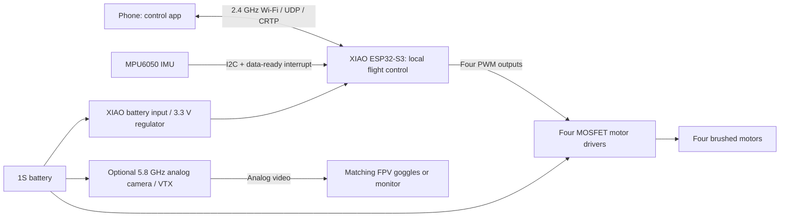

# Wi-Fi architecture and compatibility assessment

Research checked 2026-10-01. This document records source review and engineering analysis, not a physical flight test. Bench, power, radio-loss and flight acceptance still require the purchased hardware.

## Recommended architecture

Use the creator's newer **ESP-FLY kit** as the Wi-Fi version of this project. It preserves the small brushed quadcopter concept and optional analog FPV while replacing the original Arduino/nRF24 electronics with one XIAO ESP32-S3 flight controller. The [Seeed product listing](https://www.seeedstudio.com/ESP-FLY-co-create-p-6744.html) showed **$59.99, in stock, SKU 114993694** when checked; shipping, taxes and destination availability were not confirmed.

The [official Seeed/Max Imagination repository](https://github.com/Seeed-Projects/Co-Create_ESP-FLY) identifies a preassembled motor-driver/MPU6050 board, XIAO, antenna, four 6 × 15 mm motors, 30 mm propellers, 250 mAh 1S battery and printed frame/covers in the kit. Its reported masses are approximately 25 g ready to fly and 28 g with analog FPV. Those are vendor reference figures, not this workspace's measured result.

The attitude controller runs on the drone. Wi-Fi carries pilot commands and telemetry; it does not run the stabilization loop on the phone. This architecture needs neither a home router nor an internet connection. The phone does not receive video merely because it controls the drone over Wi-Fi.

## Alternatives and why they are different projects

| Approach | Extra airborne hardware | Compatibility assessment | Disposition |
|---|---|---|---|
| ESP-FLY, direct phone Wi-Fi | None beyond its native XIAO | Existing creator hardware/firmware combination; small changes still need acceptance tests | Recommended baseline |
| Phone → ground ESP32/nRF24 bridge → original Arduino drone | None | Would preserve original aircraft mass, but needs new bridge firmware, packet mapping and two independent stale-command failsafes | Feasible later experiment; not implemented or flight-qualified |
| Add an ESP8266/ESP32 to original Arduino aircraft | Board, regulator, wiring, usually another antenna | Added mass/current, serial integration, 3.3 V/5 V logic issues and scheduling work; original flight software has no verified Wi-Fi receiver path | Reject for first build |
| ESP-FLY with ESP-NOW handheld controller | No additional receiver if using supported replacement firmware | Requires matching transmitter and ESP-FC setup; ESP-NOW is not a normal phone Wi-Fi connection | Optional later branch |
| Stock Espressif ESP-Drone reference aircraft | Different board/frame/motors | Its pin maps and physical design differ from ESP-FLY; a shared project name does not make firmware interchangeable | Reference material, not a substitute BOM |
| Wi-Fi camera plus Wi-Fi control on ESP-FLY | Camera hardware, mounting and firmware additions | Current supplied workflow does not provide this integration; uncertain mass, GPIO/timer resources and latency | Separate development phase |

The ground bridge is the only original-Arduino adaptation that adds no aircraft mass. However, the inspected original `NRF24_RX.cpp` sets a timeout throttle byte of zero while its throttle mapping turns zero into 2000. Forwarding that protocol without fixing and testing the original receiver would preserve a dangerous failure mode. The existing ACK/telemetry setup also cannot be assumed to return working telemetry. See the original firmware audit before considering this branch.

ESP-NOW uses the ESP radio hardware but requires its own peer protocol. Neither a normal Wi-Fi phone nor the original nRF24 transmitter becomes an ESP-NOW transmitter through pairing. Similarly, ESP-FC's ability to use Betaflight configuration tools is not a claim that an arbitrary Betaflight firmware image will run on this XIAO. [ESP-FC upstream](https://github.com/rtlopez/esp-fc) is the relevant separate firmware project.

## Hardware facts recovered from the creator files

The creator's [project article](https://www.elektormagazine.com/labs/esp-fly-the-smallest-esp32-drone-you-can-build) links a public [hardware folder](https://drive.google.com/drive/folders/18QSSe5u8A_p2iix2rqLfaRU-QODWJp0w). Its motor/prop combination uses **0.8 mm shafts/bores**. A 30 mm propeller with a 1.0 mm or 1.5 mm bore is not a drop-in replacement.

The historical **Gerber version 331d8f50**, dated 2025-02-07, was downloaded and its outline coordinates examined. The 4.6-format, millimeter edge-cuts file contains a bounding box of **17.750 × 21.000 mm**. Header rows are **15.24 mm apart**, with **2.54 mm pitch** and fourteen **1.1 mm plated holes**. These are electrical header holes, not a screw mounting pattern. The [XIAO manufacturer's dimensions](https://wiki.seeedstudio.com/xiao_esp32s3_getting_started/) are **21 × 17.8 mm**. The assembled stack height, connector projection and current retail-kit PCB revision remain receipt-measurement items.

| Signal | Actual ESP32-S3 GPIO | XIAO header name | Evidence |
|---|---:|---|---|
| Front-right motor M1 | 7 | D8 | Creator brushed wiring + supplied firmware |
| Rear-right motor M2 | 4 | D3 | Same |
| Rear-left motor M3 | 3 | D2 | Same |
| Front-left motor M4 | 1 | D0 | Same |
| MPU6050 SDA / SCL | 5 / 6 | D4 / D5 | Creator schematic + supplied firmware |
| MPU6050 interrupt | 8 | D9 | Same |
| Battery-divider sense | 2 | D1 | Creator 10 kΩ/10 kΩ divider + hardcoded ADC driver |
| Green status LED | 9 | D10 | Creator schematic + supplied firmware |
| Red battery LED | 43 | D6 | Same |

Sources: [creator schematic](https://drive.google.com/file/d/1FaNqwE-UCqi3OMhoZBbWzKspX9wL3yQD/view), [creator brushed wiring](https://drive.google.com/file/d/1bfpXugghZp4UfVJpdKgu9iIm6AFsn5Qy/view), [Gerber archive](https://drive.google.com/file/d/1amm8nug94fygVRlJqxQfSoNjobDGX19J/view), [firmware commit](https://github.com/Seeed-Projects/Co-Create_ESP-FLY/tree/96de4d78c4d9e561c6a7ade2865a13f16b519ac3/Firmware/esp-drone).

These pin numbers are chip GPIO numbers, not sequential header labels. The stock `CONFIG_ADC1_PIN=10` is misleading: the inspected ADC driver reads ADC1 channel 1, GPIO2, and ignores the function's pin argument. The schematic confirms GPIO2. The local build profile corrects the label to 2; a future driver refactor must preserve that actual connection. A configured blue LED on GPIO11 is also not an exposed default XIAO edge-header LED.

The historical PCB archive and newer schematic need revision control: their availability does not establish that the current kit uses an identical PCB. Check silkscreen and continuity on receipt. The updated creator BOM has empty JLCPCB part-number/footprint fields and specifies `KSI2300DS-T1-GE3`, a KUU part distinct from Vishay's similarly named `Si2300DS-T1-GE3`. It is not a verified one-click assembly order. Use the assembled kit first, or complete an independent footprint/manufacturer-part/stock audit before ordering custom boards. See [the wiring review](wiring.md) for the connector and flyback-diode current-rating gaps.

The paid [creator frame STL listing](https://cults3d.com/en/3d-model/gadget/esp-fly-an-esp32-micro-drone-body-frame-3d-design-stl-files) is separate from the freely viewable electronics. No paid STL or assumed redistribution license was used here. The included retail frame is the first-flight baseline; a new parametric frame changes inertia, vibration and airflow and needs its own validation.

## Software and phone setup

1. Use the **locally patched, pinned build workflow in [firmware/README.md](../firmware/README.md)**, not the upstream prebuilt binary. It starts from the creator's ESP-FLY source and kit-specific configuration, applies the reviewed hardening patch, generates private credentials and builds in a separate directory. The tested toolchain is ESP-IDF **5.0.7**. The repository's older Windows artifacts marked `v5.0.7-dirty` are audit evidence only; they do not contain the local patch. A successful compilation does not establish safe flight behavior.
2. For iPhone, the official [ESP-Drone App Store listing](https://apps.apple.com/us/app/esp-drone/id1522247884) is live. For Android, [LiteWing on Google Play](https://play.google.com/store/apps/details?id=com.litewing.controller) currently advertises ESP-Drone-compatible UDP/CRTP control. Treat LiteWing as a compatibility candidate until its connect, thrust, axis, stop and reconnect behavior are verified against this exact firmware. App versions and phone operating-system behavior can differ.
3. After electrical checks, with propellers removed, power the assembled aircraft on a level, stationary surface. Connect the phone to `ESP-DRONE_` followed by its MAC-derived suffix, using the generated private password stored locally in `firmware/.work/wifi-password.txt`. Do not copy the stock password `12345678`: that is an audited upstream default, not the recommended build's credential. The patched profile retains AP address **192.168.43.42**, UDP port **2390**, and Wi-Fi channel **1**, and allows one associated client. The app must remain on that local network even when the OS reports no internet. Mobile-data or VPN routing may interfere; [the app developer documents this issue](https://circuitdigest.com/articles/litewing-esp32-drone-gets-new-mobile-app).
4. Check battery telemetry against a multimeter and verify every axis and motor individually. The patched profile disables automatic startup motor pulses and selects manual throttle with Angle control. Do not enable altitude or position hold: the baseline has only an MPU6050, and the presence of a mode button or compiled feature does not provide the missing height/position sensors.
5. Test app backgrounding, screen lock, force-close, Wi-Fi loss and reconnect with propellers off. The patched commander levels after **more than 300 ms** and commands zero thrust after **more than 500 ms** of stale commands; actual motor-stop latency includes task scheduling and must meet the measured limit in [acceptance-tests.md](acceptance-tests.md). By contrast, the audited stock thresholds are more than 500 ms and 2000 ms. Reconnection with nonzero throttle must remain locked until a deliberate zero-throttle command. Passing host regression tests does not pass the physical packet-replay, app-lifecycle or motor-output tests.

[Espressif's protocol documentation](https://docs.espressif.com/projects/espressif-esp-drone/en/latest/communication.html) specifies CRTP transported by UDP with a checksum. A generic browser page cannot directly send normal UDP datagrams, so the stock firmware is not automatically browser-controlled. A browser UI would require an additional transport implementation and revalidation. Use the supported app first. The upstream [support policy](https://github.com/espressif/esp-drone#support-policy) has offered only limited support since December 2022; pin a working toolchain and source instead of expecting automatic compatibility with the newest ESP-IDF.

## Power, radio and video boundaries

Motor current must come from the battery distribution path through the MOSFETs, not the XIAO 3.3 V regulator. The controller uses the designated battery pads and a common ground. Never apply the 1S battery directly to a 3.3 V GPIO. At 4.2 V battery voltage, the schematic's equal divider nominally gives 2.1 V at GPIO2; telemetry still needs calibration.

Seeed's XIAO documentation lists approximately 100 mA in Wi-Fi active mode. That is a typical operating figure, not a regulator-peak rating or a flight-current measurement. Adding a second ESP board would consume battery headroom as well as thrust margin. The same documentation lists 50 mA fast charging for the standard XIAO: 250 mAh/50 mA is already five hours ideally, before the charge taper. Confirm the actual hardware revision and charge behavior. A larger external charger is not automatically compatible with a small cell or its connector.

Preserve the supplied 2.4 GHz antenna and keep it clear of the cell, motor wires and propeller sweep. The tutorial's antenna trimming is a modification that needs RF measurement; no long-range claim is used as an acceptance result here. Wi-Fi and the original nRF24 both occupy 2.4 GHz, so a ground bridge must be evaluated for coexistence as well as latency.

For FPV, the lowest-development path is the lightweight **5.8 GHz analog camera/VTX** supported by the creator's camera cover, powered according to its actual datasheet. Confirm total camera-plus-antenna-plus-mount mass and battery-voltage range, not just the camera's advertised bare mass. Video requires a matching analog receiver; ordinary Wi-Fi capability in goggles or a phone is unrelated.

A XIAO **Sense** camera board is not an automatic upgrade. Its camera uses additional GPIOs, including GPIO11, and adds power and physical height. Streaming also adds CPU, memory and network load. The current ESP-FLY workflow does not include integrated camera support. To develop it later, first establish thrust/current margin, resolve pin and PWM-resource conflicts, isolate the control deadline from video work, and measure command age/loss with video active and stalled. Reuse of the same ESP32-S3 family alone proves none of those conditions.

For this build, Wi-Fi compatibility means **phone control and available telemetry**, with **optional separate analog FPV**. Wi-Fi digital video remains a clearly identified development option, not a promised feature of the purchased kit.
